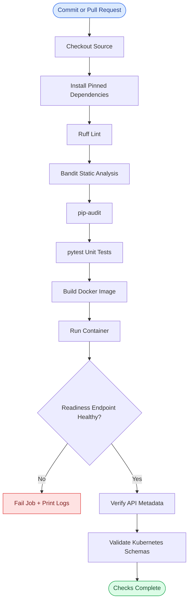
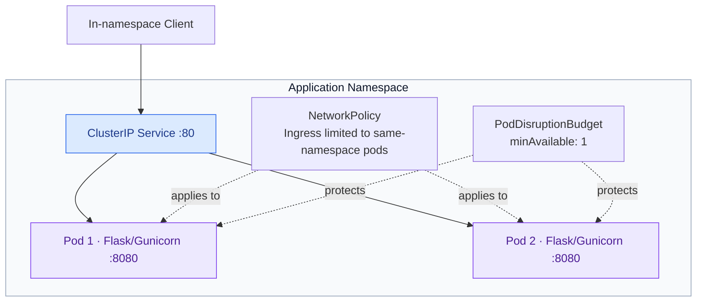

<div align="center">

# 🚀 Full CI/CD Pipeline with Jenkins, Docker & Kubernetes

**A security-first, automated delivery pipeline for a containerized Python service**

[](https://github.com/ABHILASH9519/Full-CI-CD-Pipeline-with-Jenkins-Docker-and-Kubernetes/actions/workflows/ci.yml)


[Architecture](#-system-architecture) · [Pipeline](#-ci-cd-flow) · [Quick start](#-quick-start) · [Kubernetes](#-kubernetes) · [Security](#-security-engineering)

</div>

---

## ✨ Project at a glance

This project demonstrates a production-minded workflow for validating, testing, building, and checking a containerized API before release. It combines a **Jenkins declarative pipeline**, **GitHub Actions**, **Docker**, **Kubernetes manifests**, and automated code/dependency security checks.

| Capability | Implementation |
|---|---|
| API | Flask + Gunicorn; version metadata and health endpoints |
| Code quality | Ruff linting |
| Static security | Bandit |
| Dependency risk | pip-audit |
| Tests | pytest + JUnit XML reports |
| Container | Non-root UID, slim Python base, health check |
| Kubernetes | Two replicas, probes, resource limits, rolling updates |
| Resilience | PodDisruptionBudget and topology spread |
| Network controls | Namespace-scoped ingress NetworkPolicy |
| CI automation | GitHub Actions and Jenkinsfile |

## 🧭 System architecture

The diagram below shows the major components and how the application is packaged and run. The repository contains the manifests and pipeline definitions; the actual Jenkins agent and Kubernetes cluster are supplied by the operator.

```mermaid
flowchart LR
    Dev[Developer] --> Git[GitHub Repository]
    Git --> GHA[GitHub Actions]
    Git --> Jen[Jenkins Pipeline]
    GHA --> Q[Lint · Bandit · pip-audit]
    Q --> T[pytest + JUnit]
    T --> Build[Docker Build]
    Build --> Smoke[Container Smoke Test]
    Smoke --> K8s[Kubernetes Manifests]
    K8s --> Dep[Deployment · 2 Replicas]
    Dep --> Svc[ClusterIP Service]
    Svc --> API[Flask API / Gunicorn]
    PDB[PodDisruptionBudget] -. protects availability .-> Dep
    NP[NetworkPolicy] -. restricts ingress .-> API
    style Dev fill:#E0F2FE,stroke:#0284C7,color:#0F172A
    style Git fill:#F1F5F9,stroke:#64748B,color:#0F172A
    style GHA fill:#DCFCE7,stroke:#16A34A,color:#14532D
    style Jen fill:#FEE2E2,stroke:#DC2626,color:#7F1D1D
    style Build fill:#DBEAFE,stroke:#2563EB,color:#1E3A8A
    style Dep fill:#EDE9FE,stroke:#7C3AED,color:#4C1D95
    style Svc fill:#EDE9FE,stroke:#7C3AED,color:#4C1D95
```



## 🔄 CI/CD flow



**Important:** CI validates and smoke-tests the project. It currently does **not** publish an image to a registry or deploy to a cluster.

## 🧱 Kubernetes topology



## ⚡ Quick start

**Requirements:** Python 3.12+, Git; Docker is needed for the container workflow.

```bash
git clone https://github.com/ABHILASH9519/Full-CI-CD-Pipeline-with-Jenkins-Docker-and-Kubernetes.git
cd Full-CI-CD-Pipeline-with-Jenkins-Docker-and-Kubernetes

python -m venv .venv
# Windows PowerShell:
.venv\Scripts\Activate.ps1
# macOS/Linux:
# source .venv/bin/activate

python -m pip install -r requirements-dev.txt
ruff check app tests
bandit -q -r app
pip-audit -r requirements.txt
pytest -q
python -m app.app
```

The local development server listens on `127.0.0.1:8080`.

### API endpoints

| Method | Endpoint | Purpose |
|---|---|---|
| GET | `/` | Service name, status, and version |
| GET | `/api/v1/info` | Version and environment metadata |
| GET | `/health/live` | Liveness probe |
| GET | `/health/ready` | Readiness probe |
| GET | `/health` | Compatibility health endpoint |

## 🐳 Docker

```bash
docker build -t cicd-demo:local .
docker run --rm -p 8080:8080 cicd-demo:local
```

Check [http://127.0.0.1:8080/health/ready](http://127.0.0.1:8080/health/ready). The image runs Gunicorn as UID `10001`, not root, and includes a Docker health check.

## ☸️ Kubernetes

The manifests use `cicd-demo:local` as a **local image placeholder**. Build/load that image into your local cluster or change it to an immutable registry image before deploying remotely.

```bash
kubectl apply -f k8s/deployment.yaml
kubectl apply -f k8s/service.yaml
kubectl apply -f k8s/pod-disruption-budget.yaml
kubectl apply -f k8s/network-policy.yaml
kubectl rollout status deployment/cicd-demo
kubectl port-forward service/cicd-demo 8081:80
```

Then open [http://127.0.0.1:8081/health/ready](http://127.0.0.1:8081/health/ready).

> **NetworkPolicy note:** ingress is restricted to pods in the same namespace. Explicitly allow approved ingress-controller or monitoring pods if needed. Enforcement depends on the cluster CNI.

## 🛡️ Security engineering

- **Code and dependency gates:** Ruff, Bandit and pip-audit run before container verification.
- **Least privilege:** container and pod run as a non-root UID; privilege escalation is disabled and Linux capabilities are dropped.
- **Filesystem hardening:** read-only container root filesystem with bounded temporary storage.
- **Kubernetes security:** seccomp RuntimeDefault and service-account token automount disabled.
- **Operational resilience:** readiness/startup/liveness probes, rolling-update configuration, two replicas and a disruption budget.
- **Network boundaries:** namespace-scoped ingress policy.
- **Secret hygiene:** no credentials, registry passwords or kubeconfig files should be committed.

See [Threat Model](docs/threat-model.md), [Release Runbook](docs/release-runbook.md), and [Jenkins Setup](docs/jenkins-setup.md).

## 🗂️ Repository map

```text
.
├── app/                       # Flask API
├── tests/                     # Unit tests
├── k8s/
│   ├── deployment.yaml        # Hardened, two-replica Deployment
│   ├── service.yaml           # Internal ClusterIP Service
│   ├── pod-disruption-budget.yaml
│   └── network-policy.yaml
├── docs/
│   ├── architecture.md
│   ├── jenkins-setup.md
│   ├── release-runbook.md
│   └── threat-model.md
├── .github/workflows/ci.yml   # GitHub Actions quality + container checks
├── Jenkinsfile                # Jenkins pipeline
├── Dockerfile
├── Makefile
├── pyproject.toml
├── requirements.txt
└── requirements-dev.txt
```

## 🚧 Release boundary and next steps

This repository does not provision Jenkins, a registry, cloud infrastructure, or a Kubernetes cluster. The automated workflow does not push images or deploy to Kubernetes.

Before production use, add image scanning and signing, SBOM attestation, immutable image digests, protected environment approvals, external secret management, environment overlays, rollback automation and runtime observability. Dependency advisories change over time; review audit output regularly.

---

<div align="center">

**Built as a hands-on DevOps portfolio project** · CI validation is not a claim of production deployment.

</div>
