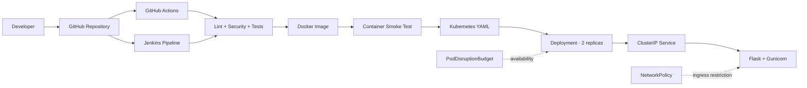
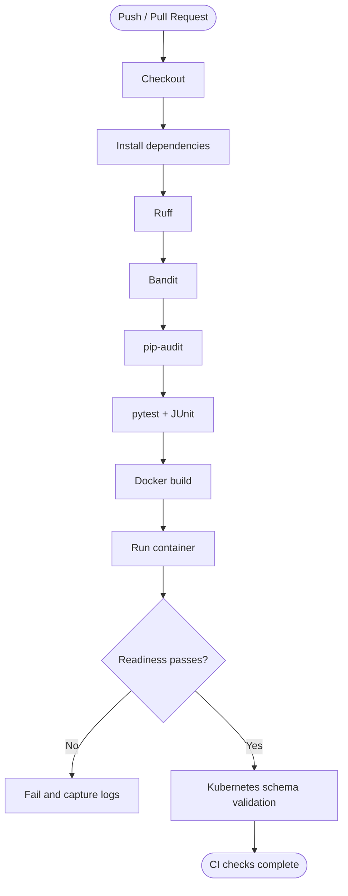
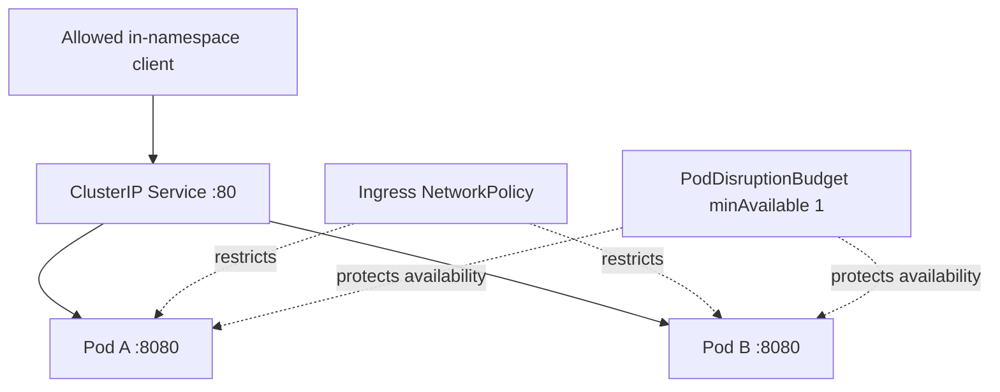

# System Architecture

This page is the source companion for the diagrams embedded in the repository README. GitHub renders the Mermaid diagrams directly, so they stay version-controlled with the documentation.

## Component architecture

## CI workflow

## Kubernetes request path

## Component responsibilities

| Component | Responsibility |
|---|---|
| GitHub Actions | Repeatable lint, static security, dependency audit, tests, Docker smoke test, Kubernetes schema validation |
| Jenkinsfile | Jenkins-agent pipeline for quality/security checks, unit tests, image build and smoke test |
| Dockerfile | Reproducible runtime image using a non-root account and health check |
| Kubernetes Deployment | Two replicas, probes, rolling update, resource bounds and pod security settings |
| Service | Stable internal endpoint for application pods |
| PodDisruptionBudget | Protects a minimum of one available pod during supported voluntary disruptions |
| NetworkPolicy | Restricts ingress to same-namespace pods; requires compatible CNI enforcement |

## Deployment boundary

The CI workflow does not publish images or apply Kubernetes manifests. The manifests are examples and use `cicd-demo:local`; a remote deployment requires a registry image pinned by immutable digest, cluster-specific network rules, secrets managed outside Git, and an approved release process.
